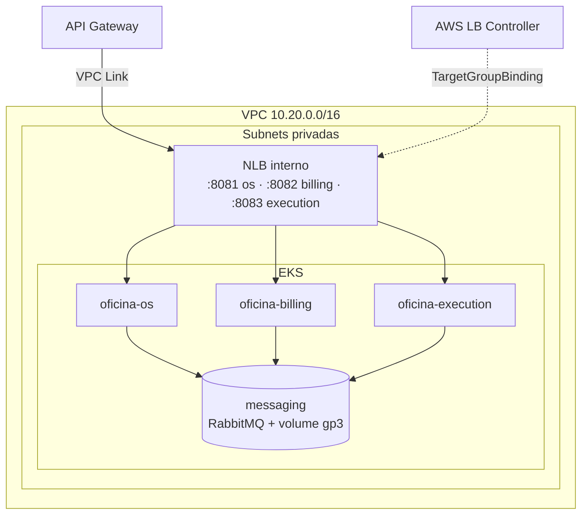

# oficina-infra-k8s

Infraestrutura como código (Terraform) do **cluster Kubernetes gerenciado** da Oficina
Mecânica (Tech Challenge FIAP 15SOAT): **VPC + Amazon EKS** com escalabilidade e add-ons e, a
partir da Fase 4, os recursos compartilhados pelos três microsserviços: RabbitMQ, namespaces,
volume persistente e um listener do NLB por serviço.

> Repositório 2 de 4. É o **primeiro** a ser provisionado (cria a VPC usada pelos demais).

## Propósito

- Rede (VPC) e cluster **EKS** (managed node group).
- Add-ons: metrics-server (HPA), AWS Load Balancer Controller, EBS CSI driver e a integração
  K8s do New Relic.
- **RabbitMQ** (Cluster Operator oficial) no namespace `messaging`, com um usuário por serviço.
- Namespaces `oficina-os`, `oficina-billing` e `oficina-execution`.
- **NLB interno** com um listener e um target group por serviço, para o VPC Link do API Gateway.

## Tecnologias

- **Terraform** (providers aws, kubernetes, helm, alekc/kubectl, http, random) e módulos
  `terraform-aws-modules/{vpc,eks,iam}`.
- **Amazon EKS**, metrics-server, AWS Load Balancer Controller, add-on `aws-ebs-csi-driver`,
  New Relic nri-bundle.
- **RabbitMQ Cluster Operator v2.21.1** e imagem `rabbitmq:4.1-management`.
- Estado remoto **S3** + trava **DynamoDB**. CI/CD **GitHub Actions** (OIDC).

## Arquitetura



## Recursos principais

| Arquivo | O que cria |
| --- | --- |
| `main.tf` | VPC (2 AZs, NAT único), EKS (IRSA habilitado) e o NLB interno: um `aws_lb_target_group` (alvos IP, porta 8080, health check `/health/ready`) e um `aws_lb_listener` por serviço de `var.servicos` |
| `addons.tf` | metrics-server, aws-load-balancer-controller (IRSA) e nri-bundle, com o Prometheus agent (só com a licença) |
| `storage.tf` | add-on `aws-ebs-csi-driver` com role IRSA própria e a StorageClass `gp3`, marcada como padrão |
| `namespaces.tf` | `oficina-<serviço>` e `messaging` |
| `rabbitmq.tf` | Operator, `RabbitmqCluster`, usuários e secrets |

### RabbitMQ

- **Operator v2.21.1, conferido por SHA-256.** O `cluster-operator.yml` da release é baixado no
  plan, e o plan falha se o arquivo mudar. A partir da v2.22 o operator exige o cert-manager
  (webhooks) e o RabbitMQ 4.2.4+ (novo startup probe), por isso a 2.21. Os requests do
  operator caem de 200m/500Mi para 50m/128Mi.
- **Um usuário por serviço** (`os-service`, `billing-service`, `execution-service`), com
  permissão só no vhost `oficina`. As senhas saem de `random_password` e vão para o Secrets
  Manager em `<projeto>-<ambiente>/rabbitmq/<serviço>`, no formato
  `{"host","port","vhost","username","password"}`. É o `RABBITMQ_SECRET_ID` do CD de cada serviço.
- **Definitions importadas no boot** (`load_definitions`). Assim não precisa do Topology
  Operator nem do cert-manager. Mudou uma senha? Reinicie o pod `rabbitmq-server-0`.
- **Usuário `admin` da UI.** Com definitions no boot, o RabbitMQ não cria o usuário padrão do
  operator: o secret `rabbitmq-default-user` existe, mas o usuário não. A senha do admin fica
  em `<projeto>-<ambiente>/rabbitmq/admin`. Acesso:
  `kubectl -n messaging port-forward svc/rabbitmq 15672` e abrir `http://localhost:15672`.
- **Métricas (Etapa 5):**
  - o plugin Prometheus expõe as métricas por fila (`prometheus.return_per_object_metrics`), por exemplo `rabbitmq_queue_messages{queue="billing-estornar-pagamento_error"}`;
  - o pod é anotado para o scrape (`prometheus.io/scrape`, porta 15692);
  - o Prometheus agent do `nri-bundle` coleta e manda essas métricas ao New Relic, para o dashboard e os alertas das filas `_error`;
  - a métrica por fila foi conferida num container `rabbitmq:4.1-management` com a mesma configuração.
- **Réplicas:** 1 em homolog. Em prod, `rabbitmq_replicas = 3` com *quorum queues*. A
  memória fica com request igual ao limit (`rabbitmq_memory`, 512Mi), como o operator recomenda.
- Validado em 2026-11-16 num cluster kind: o operator sobe com os recursos reduzidos, o
  `RabbitmqCluster` fica com todas as condições `True` e as definitions criam os usuários,
  o vhost e as permissões.

### NLB e security groups

O NLB não tem security group. Os alvos são IP e chegam aos pods pela regra `nlb_to_pods_8080`
do SG dos nós (CIDR da VPC). Isso vale para o API Gateway (VPC Link) e para a Lambda, que chama
o endpoint interno do os-service pelo listener dele.

## Capacidade dos nós (decidir antes do apply)

O padrão do node group continua `t3.micro`, que tem 1 GiB. Com `node_max_pods = 17`, o EKS
reserva 11 MiB por pod mais 255 MiB para o kubelet, e há 100 MiB de reserva para despejo. Sobram
cerca de 400 MiB alocáveis por nó, o que **não comporta** o pod do RabbitMQ (512 MiB) nem os
três serviços.

Na conta do Free Plan, `t3.small` (2 GiB) também é elegível e deixa cerca de 1,4 GiB alocável
por nó. Uma estimativa de requests em homolog:

| Componente | Memória (requests) |
| --- | --- |
| RabbitMQ + operator | 512 Mi + 128 Mi |
| 3 serviços × 1 réplica | 3 × 256 Mi (uso medido no kind: de 80 a 165 Mi) |
| CoreDNS, metrics-server, EBS CSI, LB Controller | ~ 500 Mi |
| New Relic (nri-bundle, se ligado) | ~ 400–600 Mi |

Com 2 × `t3.small`, isso fica em torno de 2,4 GiB de 2,8 GiB alocáveis, sem folga para o HPA subir réplicas. Com 3 × `t3.small` (4,2 GiB), sobra espaço para o HPA. Para usar:
`-var='node_instance_types=["t3.small"]'`.

## Executar / deploy

Deploy automático em `homolog`/`prod`. Requer `AWS_DEPLOY_ROLE_ARN`, `NEW_RELIC_LICENSE_KEY`
(secrets) e `AWS_REGION`, `TF_STATE_BUCKET`, `TF_LOCK_TABLE` (variables).

```bash
terraform init -backend-config="bucket=<S3>" -backend-config="key=infra-k8s/homolog/terraform.tfstate" ...
terraform apply -var="environment=homolog"
```

**Ordem na migração da Fase 3 para a 4:** o listener único (porta 80) e o target group `app`
dão lugar a um por serviço. Depois do apply daqui, aplique o `oficina-lambda-auth` (rotas por
serviço) e rode o CD de cada serviço, que registra os pods no target group novo. Até o CD do
os-service rodar, a API dele fica fora do NLB.

## Testes

```bash
terraform init -backend=false
terraform test
```

`tests/plataforma.tftest.hcl` roda sem conta AWS nem cluster. Os providers são mockados, e a
VPC, o EKS e as roles IRSA são substituídos pelas saídas que os recursos daqui usam. Os casos:

- um listener e um target group por serviço;
- os namespaces;
- EBS CSI com IRSA e a gp3 como padrão;
- usuários, secrets e definitions do RabbitMQ;
- operator fixado e com recursos reduzidos;
- métricas do RabbitMQ por fila e coletadas pelo nri-bundle;
- 3 réplicas em prod;
- checksum diferente derruba o plan;
- validações de réplicas e do os-service obrigatório.

O CI roda `fmt`, `validate` e `test` em todo PR.

## Outputs

| Output | Para quê |
| --- | --- |
| `cluster_name`, `cluster_endpoint`, `oidc_provider_arn` | CDs dos serviços e roles IRSA |
| `vpc_id`, `vpc_cidr`, `private_subnet_ids`, `public_subnet_ids`, `nodes_security_group_id` | RDS dos serviços, Lambda e VPC Link |
| `nlb_dns_name`, `listener_ports` | `OS_SERVICE_URL` da Lambda (`http://<dns>:<porta do os>`) |
| `listener_arns` | Integração de cada rota do API Gateway |
| `target_group_arns` | `TARGET_GROUP_ARN` do CD de cada serviço (TargetGroupBinding) |
| `service_namespaces` | Namespace de cada serviço |
| `rabbitmq_host`, `rabbitmq_secret_ids`, `rabbitmq_admin_secret_id` | Credenciais do broker |
| `app_listener_arn`, `app_target_group_arn` | Obsoletos (Fase 3): apontam para o os-service |
